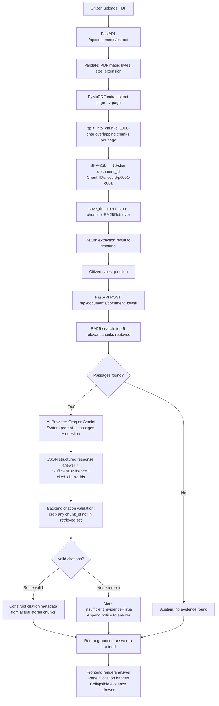

# CitizenAssist AI — Project Handover Document

> **Last updated:** 2026-11-18  
> **Branch containing latest implementation:** `main` (all feature branches merged via PRs)  
> **Repository:** https://github.com/abhigyan-21/CitizenAssistAI *(private — collaborator access required)*

---

## 1. Project Overview

**CitizenAssist AI** is a research software prototype that helps ordinary citizens understand Indian administrative and government documents. Its target users are non-expert citizens who receive complex PDF documents — welfare scheme guidelines, government notices, eligibility rules, administrative forms — and need plain-English explanations of their contents.

### Problem Being Addressed

Government documents in India are dense, formal and often written for administrative audiences rather than citizens. A farmer receiving a PM-KISAN scheme guideline PDF, or a household receiving an administrative notice, may struggle to identify what the document requires of them, what benefits they are entitled to, or what deadlines apply. The language barrier is compounded when documents exist only in English but users are more comfortable in Hindi or a regional language.

### How AI Helps

CitizenAssist AI enables a citizen to:
1. Upload a PDF administrative document.
2. See the full extracted text, page by page, so the source content is transparent.
3. Search the document using natural language keywords via BM25 retrieval.
4. Ask a natural-language question and receive an AI-generated answer **grounded exclusively in the uploaded document's retrieved passages**, with citations linking the answer back to specific pages.

The AI never answers from general knowledge alone. Every generated answer is required to cite specific passages retrieved from the document, and the backend validates all citations before returning them to the user.

### Relationship to CDTM Research

The software is a **research demonstrator** for the **Citizen Document Trustworthiness Model (CDTM)** — a research framework being developed to evaluate how faithfully and safely AI systems transform and explain administrative documents. The prototype currently implements the evidence-grounding dimension most fully. Evaluation engines for the other four CDTM dimensions are planned but not yet built.

> **Important:** This is a research prototype, not a production government application. It has not been officially endorsed by any government body. The answers it generates are probabilistic AI outputs and must not be relied upon for legal or administrative decisions without verification.

---

## 2. Research Background

### Research Title
*A Multilingual AI Framework for Citizen-Facing Administrative Document Understanding*

### CDTM — Citizen Document Trustworthiness Model

CDTM is the core research framework. It defines five dimensions along which an AI system's handling of administrative documents can be evaluated. The prototype is built to demonstrate these dimensions, not yet to measure them fully.

#### The Five CDTM Dimensions

**a. Source Fidelity**
Faithful preservation of source content and document structure during acquisition and extraction.
- Did the system capture the full text of the PDF without loss, distortion or hallucination during extraction?
- Are headings, amounts, dates and eligibility conditions preserved exactly?
- Pages with scanned images where OCR would be required are currently flagged but not processed.

**b. Semantic Fidelity**
Preservation of original meaning, conditions, relationships and critical implications during simplification or reformulation.
- When the system rephrases or simplifies a clause, does the simplified version preserve all qualifications, exclusions and conditions?
- Omitting an eligibility exclusion in a simplified answer would constitute a semantic fidelity failure.

**c. Evidence Grounding**
Generated answers and explanations must be supported by identifiable and adequate evidence from the original document.
- Every AI-generated answer must be traceable to specific retrieved passages.
- The backend validates that every citation the model returns was actually retrieved — fabricated or invented citations are dropped.
- If no passage contains sufficient evidence, the system abstains rather than generating an unsupported answer.

**d. Cross-Lingual Fidelity**
Preservation of meaning, terminology and critical information during translation between languages.
- When the same content is translated from English to Hindi (or a regional language), are deadlines, amounts and eligibility criteria preserved?
- Administrative terminology must not be lost or distorted in translation.
- *(This dimension is planned for a later phase — not yet implemented.)*

**e. Citizen Accessibility**
Whether non-expert citizens can understand and practically use the information.
- Is the generated explanation readable by a person without administrative or legal expertise?
- Does the explanation help the citizen identify what action they need to take?
- *(Empirical evaluation of this dimension requires a user study — not yet conducted.)*

#### Dimension Boundaries and Relationships

The five dimensions are independent evaluation axes but interact:
- A high Source Fidelity score ensures the downstream system works with accurate input.
- Semantic Fidelity can only be evaluated relative to source content that has been faithfully extracted (depends on Source Fidelity).
- Evidence Grounding ensures that answers are traceable but does not by itself guarantee Semantic Fidelity — a cited passage can be misinterpreted.
- Cross-Lingual Fidelity is a specialised form of Semantic Fidelity that applies across language boundaries.
- Citizen Accessibility is an end-user outcome that depends on all the other dimensions being satisfied.

#### Research Scope

- **Geography:** India
- **Document types:** Government welfare scheme guidelines, administrative notices, eligibility rules, government forms
- **Languages:** English and Hindi (primary), with one selected regional Indian language planned
- **Status:** Research prototype; empirical evaluation not yet completed; no validated performance metrics exist

---

## 3. System Architecture

### Component Overview

```
Browser (React + Vite)
      │  multipart/form-data upload
      │  JSON REST calls
      ▼
FastAPI Backend (Python 3.11, Uvicorn)
      │
      ├── PDF Processing (PyMuPDF)
      │       └── Page extraction → Chunking → SHA-256 document ID
      │
      ├── In-Memory Document Store (Python dict + RLock)
      │       └── Stores chunks + BM25Retriever per document
      │
      ├── BM25 Retrieval (pure Python, no external NLP library)
      │       └── Tokenize → BM25Okapi scoring → ranked chunks
      │
      ├── QAService
      │       └── BM25 retrieval → AI Provider → Citation validation
      │
      └── AI Provider Layer
              ├── AIProvider (ABC)
              ├── GroqProvider   (default: llama-3.3-70b-versatile)
              └── GeminiProvider (selectable: gemini-3.8-flash)
```

### Request Flow — Document Upload to Citizen Answer



### Key Architectural Decisions

| Decision | Rationale |
|----------|-----------|
| In-memory storage | Simplicity for research prototype; no database setup required |
| Pure-Python BM25 | No external NLP dependency; transparent, inspectable retrieval |
| AI provider abstraction | Swappable providers; Groq and Gemini currently implemented |
| Backend citation validation | Prevents the model from fabricating citations; grounding integrity enforced server-side |
| SHA-256 document ID | Deterministic, collision-resistant identifier from file content |
| `max_retries=0` on Groq SDK | Surfaces errors immediately; avoids hidden retry latency |

---

## 4. Complete Project Structure

Inspected from actual repository. Generated artifacts (`dist/`, `__pycache__`), virtual environments (`.venv/`, `node_modules/`) and secret files (`.env`) are excluded.

```
CitizenAssistAI/
│
├── PROJECT_HANDOVER.md          ← This document
├── REMAINING_WORK.md            ← Development roadmap for next developer
├── README.md                    ← Brief project introduction
│
├── backend/
│   ├── .env.example             ← Template for local environment configuration
│   ├── requirements.txt         ← Python dependencies
│   │
│   ├── app/
│   │   ├── main.py              ← FastAPI app entry point, CORS middleware, router
│   │   │
│   │   ├── core/
│   │   │   └── config.py        ← Pydantic-settings config (all env vars)
│   │   │
│   │   ├── api/
│   │   │   └── routes.py        ← All HTTP endpoints: extract, search, ask
│   │   │
│   │   ├── document/
│   │   │   ├── pdf_extractor.py ← PyMuPDF extraction, chunking, document_id
│   │   │   └── store.py         ← In-memory document store + BM25 index management
│   │   │
│   │   ├── retrieval/
│   │   │   └── bm25.py          ← Pure-Python BM25Okapi + BM25Retriever + tokenizer
│   │   │
│   │   ├── ai/
│   │   │   ├── __init__.py      ← Exports: AIProvider, GroundedAnswerResponse, GeminiProvider, GroqProvider, MockAIProvider
│   │   │   ├── base.py          ← Abstract AIProvider interface + GroundedAnswerResponse schema
│   │   │   ├── gemini.py        ← GeminiProvider: google-genai SDK, structured output
│   │   │   ├── groq.py          ← GroqProvider: groq SDK AsyncGroq, JSON object mode
│   │   │   └── mock.py          ← MockAIProvider for automated tests
│   │   │
│   │   └── services/
│   │       └── qa_service.py    ← QAService: BM25 → provider → citation validation
│   │
│   └── tests/
│       ├── __init__.py
│       ├── test_api.py          ← PDF upload, search endpoint and document store tests
│       ├── test_bm25.py         ← BM25 tokenizer, scoring and retriever tests
│       ├── test_qa.py           ← QAService, citation validation and ask-route tests
│       └── test_groq.py         ← GroqProvider unit tests + provider selection tests
│
└── frontend/
    ├── package.json             ← Node.js dependencies (React, Vite, lucide-react)
    ├── vite.config.js           ← Vite + React plugin configuration
    ├── index.html               ← HTML shell
    └── src/
        ├── main.jsx             ← React entry point
        ├── App.jsx              ← All UI: upload, extraction display, search, Q&A
        └── styles.css           ← Civic Editorial design system (CSS variables, all component styles)
```

### File Responsibilities Summary

| File | Responsibility |
|------|---------------|
| `app/main.py` | FastAPI application factory, CORS, router registration, `/health` endpoint |
| `app/core/config.py` | Reads all environment variables via pydantic-settings; single settings singleton |
| `app/api/routes.py` | HTTP route handlers: document extraction, BM25 search, evidence-grounded Q&A |
| `app/document/pdf_extractor.py` | PyMuPDF text extraction, overlapping chunking, document_id generation |
| `app/document/store.py` | Thread-safe in-memory store; persists chunks and BM25Retriever per document |
| `app/retrieval/bm25.py` | Pure-Python BM25Okapi implementation, tokenizer, BM25Retriever wrapper |
| `app/ai/base.py` | Abstract `AIProvider` base class; `GroundedAnswerResponse` Pydantic model |
| `app/ai/gemini.py` | Gemini provider using `google-genai` SDK, async, structured JSON output |
| `app/ai/groq.py` | Groq provider using `groq` SDK AsyncGroq, JSON object mode, error mapping |
| `app/ai/mock.py` | Configurable mock provider for tests (no network) |
| `app/services/qa_service.py` | Orchestrates BM25 retrieval → AI generation → citation validation |
| `frontend/src/App.jsx` | All React UI: upload, extraction view, BM25 search, Q&A with citation badges |
| `frontend/src/styles.css` | Civic Editorial design system: CSS custom properties, all component styles |

---

## 5. Feature Specifications

### 5.1 PDF Upload and Validation

**Input:** Multipart form-data file upload  
**Output:** Extraction result JSON or HTTP error  
**Files:** `app/api/routes.py`, `app/document/pdf_extractor.py`

Validation checks (in order):
1. File extension must be `.pdf`
2. MIME type must be `application/pdf`
3. File size must not exceed `MAX_UPLOAD_MB` (default 20 MB)
4. First 5 bytes must be `%PDF-` (magic bytes)

**Limitations:** Does not validate PDF internal structure beyond the magic bytes check.

---

### 5.2 Page-by-Page Extraction

**Input:** Raw PDF bytes  
**Output:** `pages` list — one entry per page with `page_number` and `text`  
**Files:** `app/document/pdf_extractor.py` → `extract_pdf()`

Uses PyMuPDF (`pymupdf`) to extract selectable text. Pages with no selectable text (scanned images) produce a warning and an empty text string. **OCR is not implemented** — pages requiring OCR are flagged in the `warnings` list.

---

### 5.3 Page-Aware Text Chunking

**Input:** Page text string  
**Output:** List of overlapping text chunks, each bounded to its source page  
**Files:** `app/document/pdf_extractor.py` → `split_into_chunks()`

Parameters:
- `max_chars=1000` — maximum characters per chunk
- `overlap=150` — overlap characters to preserve context across chunk boundaries
- Chunks do not cross page boundaries
- Split prefers sentence boundaries (`. `), falling back to word boundaries

---

### 5.4 Chunk IDs and Document IDs

**Document ID:** First 16 hex characters of the SHA-256 hash of the raw PDF bytes. Deterministic: the same file always produces the same ID.

**Chunk ID format:** `{document_id}-p{page_number:04d}-c{chunk_index:03d}`  
Example: `a3f1b2c4d5e6f7a8-p0003-c002` (page 3, second chunk on that page)

---

### 5.5 In-Memory Document Store

**Files:** `app/document/store.py`

Stores per document:
- `filename` — original upload filename
- `chunks` — full list of chunk dicts
- `retriever` — initialised `BM25Retriever` instance

Thread-safe via `threading.RLock`. **Data is lost on backend restart.** No persistence layer.

---

### 5.6 BM25 Ranking and Retrieval

**Files:** `app/retrieval/bm25.py`

Pure-Python implementation with no external NLP dependencies.

- **Tokenizer:** Lowercased alphanumeric tokens, hyphenated terms preserved (e.g. `pm-kisan`)
- **Algorithm:** BM25Okapi with smoothed IDF (always non-negative), `k1=1.5`, `b=0.75`
- **Retriever:** Wraps chunks for a single document; scores are raw BM25 values, not percentages
- Chunks scoring ≤ 0 are excluded from results

**Limitations:** Lexical retrieval only — no semantic similarity, no synonym matching, no stemming. Query terms must share tokens with document text to be retrieved.

---

### 5.7 Search Endpoint

See API documentation (Section 6).

---

### 5.8 AI-Assisted Document Understanding (Evidence-Grounded Q&A)

**Files:** `app/services/qa_service.py`, `app/ai/groq.py`, `app/ai/gemini.py`

Full pipeline: question → BM25 retrieval → AI generation → citation validation → structured response.

The system prompt instructs the model to:
- Use only the provided source passages
- Never use outside knowledge or extrapolate
- Set `insufficient_evidence=true` when passages are inadequate
- Include only real chunk IDs from the supplied passages

---

### 5.9 Citation Generation and Backend Citation Validation

**Files:** `app/services/qa_service.py`

After generation, every `cited_chunk_id` returned by the model is validated against the set of actually retrieved chunks (via `retrieved_lookup` dict). Fabricated or unretrieved chunk IDs are silently dropped. If the model claimed to answer but zero valid citations remain, `insufficient_evidence` is set to `True` and a notice is appended to the answer.

Citation metadata constructed from actual stored chunks includes: `chunk_id`, `document_id`, `filename`, `page_number`, `text`.

**Important:** Citation validation confirms that the model cited a passage that was retrieved. It does not confirm that the generated claim is factually correct or that the cited passage is an authoritative government record.

---

### 5.10 Insufficient-Evidence Abstention

Two abstention paths:
1. **BM25 returns zero passages** → immediate abstention, no AI call made
2. **AI sets `insufficient_evidence=true`** OR **zero valid citations survive validation** → abstention notice returned to frontend

---

### 5.11 Frontend Search and Answer Presentation

**Files:** `frontend/src/App.jsx`, `frontend/src/styles.css`

- Phase 01: PDF upload with dynamic button states
- Phase 02: Extracted page text display + BM25 keyword search with scored results
- Phase 03: AI-Assisted Q&A panel with grounded answer, `[Page N]` citation badges (clickable scroll-to-highlight), collapsible supporting evidence drawer

---

### 5.12 Civic Editorial Design System

See Section 12.

---

## 6. API Documentation

Base URL: `http://localhost:8000`  
Interactive docs: `http://localhost:8000/docs`

---

### GET /health

**Purpose:** Backend liveness check  
**Request:** None  
**Response:**
```json
{ "status": "ok", "application": "CitizenAssist AI" }
```

---

### POST /api/documents/extract

**Purpose:** Upload a PDF and extract its text, chunks and document ID  
**Request:** `multipart/form-data` with field `file` (PDF file)  
**Response (200):**
```json
{
  "filename": "pm_kisan_guidelines.pdf",
  "document_id": "a3f1b2c4d5e6f7a8",
  "page_count": 12,
  "pages": [
    { "page_number": 1, "text": "PM-KISAN Scheme Guidelines..." }
  ],
  "chunks": [
    {
      "chunk_id": "a3f1b2c4d5e6f7a8-p0001-c001",
      "document_id": "a3f1b2c4d5e6f7a8",
      "page_number": 1,
      "chunk_index": 1,
      "text": "The PM-KISAN scheme provides...",
      "source_type": "pdf_extraction"
    }
  ],
  "chunk_count": 47,
  "warnings": [],
  "source_fidelity_status": "not_evaluated"
}
```

**Errors:**
| Status | Condition |
|--------|-----------|
| 400 | File fails PDF magic byte check |
| 413 | File exceeds MAX_UPLOAD_MB |
| 415 | Not a PDF (extension or MIME type) |
| 422 | PyMuPDF cannot parse the PDF |

**Note:** `source_fidelity_status` is `"requires_review"` when warnings are present, `"not_evaluated"` otherwise. This is a placeholder field — full CDTM evaluation is not yet implemented.

---

### POST /api/documents/{document_id}/search

**Purpose:** BM25 keyword search within a specific document  
**Request body:**
```json
{
  "query": "eligibility farmer family",
  "top_k": 5
}
```
**Response (200):**
```json
{
  "document_id": "a3f1b2c4d5e6f7a8",
  "query": "eligibility farmer family",
  "total_results": 3,
  "results": [
    {
      "chunk_id": "a3f1b2c4d5e6f7a8-p0002-c001",
      "document_id": "a3f1b2c4d5e6f7a8",
      "page_number": 2,
      "text": "A landholder farmer family is defined as...",
      "score": 7.4231
    }
  ]
}
```

**Errors:**
| Status | Condition |
|--------|-----------|
| 404 | document_id not in memory store |

**Note:** `score` is a raw BM25 relevance score, not a percentage or ratio.

---

### POST /api/documents/search

**Purpose:** BM25 search with document_id in the request body (alternative to path parameter)  
**Request body:**
```json
{
  "document_id": "a3f1b2c4d5e6f7a8",
  "query": "exclusion criteria",
  "top_k": 5
}
```
**Response:** Same as above  
**Errors:**
| Status | Condition |
|--------|-----------|
| 400 | `document_id` field missing from body |
| 404 | Document not found |

---

### POST /api/documents/{document_id}/ask

**Purpose:** Evidence-grounded question answering using AI provider + BM25 retrieval  
**Request body:**
```json
{
  "query": "What is the annual financial benefit for an eligible family?",
  "top_k": 5
}
```
*(Field `question` is accepted as an alias for `query`.)*

**Response (200):**
```json
{
  "document_id": "a3f1b2c4d5e6f7a8",
  "question": "What is the annual financial benefit for an eligible family?",
  "answer": "According to the scheme guidelines, eligible farmer families receive Rs 6,000 per year, paid in three equal instalments of Rs 2,000.",
  "insufficient_evidence": false,
  "cited_chunk_ids": ["a3f1b2c4d5e6f7a8-p0001-c001"],
  "citations": [
    {
      "chunk_id": "a3f1b2c4d5e6f7a8-p0001-c001",
      "document_id": "a3f1b2c4d5e6f7a8",
      "filename": "pm_kisan_guidelines.pdf",
      "page_number": 1,
      "text": "The PM-KISAN scheme provides income support of Rs 6,000 per year..."
    }
  ],
  "retrieved_evidence": [ /* top-5 BM25 passages used as context */ ],
  "provider_info": {
    "provider": "groq",
    "model": "llama-3.3-70b-versatile"
  }
}
```

**Abstention response (insufficient evidence):**
```json
{
  "insufficient_evidence": true,
  "answer": "The uploaded administrative document does not contain passages relevant to this question. No verifiable evidence was found.",
  "citations": [],
  "cited_chunk_ids": []
}
```

**Errors:**
| Status | Condition |
|--------|-----------|
| 404 | Document not in memory store |
| 422 | Empty question field |
| 429 | AI provider rate limit exceeded |
| 503 | AI provider not configured (missing API key) or unknown provider |
| 504 | AI provider request timed out |
| 502 | Other AI provider error |

---

## 7. AI Provider Architecture

### Abstract Interface

**File:** `app/ai/base.py`

```python
class AIProvider(ABC):
    @abstractmethod
    async def generate_grounded_answer(
        self,
        question: str,
        passages: list[dict],
        system_instruction: str | None = None,
    ) -> GroundedAnswerResponse: ...

class GroundedAnswerResponse(BaseModel):
    answer: str
    insufficient_evidence: bool
    cited_chunk_ids: list[str]
    model_name: str
    raw_response: dict | None
```

Adding a new provider requires only implementing `generate_grounded_answer` on a class that inherits `AIProvider`.

### Provider Selection

Controlled via `AI_PROVIDER` environment variable. Resolved in `QAService.get_provider()`. **No automatic fallback** — an error from the configured provider surfaces as an HTTP error, not a silent switch.

| `AI_PROVIDER` | Provider class | Required env var | Default model |
|---------------|---------------|-----------------|---------------|
| `groq` *(default)* | `GroqProvider` | `GROQ_API_KEY` | `llama-3.3-70b-versatile` |
| `gemini` | `GeminiProvider` | `GEMINI_API_KEY` | `gemini-3.8-flash` |

### Groq Provider (default)

**File:** `app/ai/groq.py`  
**SDK:** `groq.AsyncGroq` (official Groq Python SDK)  
**Structured output:** JSON Object Mode (`response_format={"type": "json_object"}`) + Pydantic validation  
**Retries:** `max_retries=0` (surfaces errors immediately)  
**Timeout:** `asyncio.wait_for` wrapping the SDK call; default 30 seconds

Error mapping:
| Groq exception | Mapped to |
|----------------|-----------|
| `AuthenticationError` | `RuntimeError` ("Check GROQ_API_KEY") → HTTP 503 |
| `RateLimitError` | Re-raised → HTTP 429 |
| `APITimeoutError` | `TimeoutError` → HTTP 504 |
| `APIConnectionError` | `RuntimeError` → HTTP 503 |
| `APIStatusError` (429) | HTTP 429 |
| `APIStatusError` (other) | HTTP 502 |
| `asyncio.TimeoutError` | `TimeoutError` → HTTP 504 |
| Malformed JSON | Returns abstention response (no exception) |

### Gemini Provider (selectable)

**File:** `app/ai/gemini.py`  
**SDK:** `google-genai` (official Google Gen AI Python SDK)  
**Structured output:** `GenerateContentConfig` with `response_mime_type="application/json"` and `response_schema=_GroundedAnswerSchema` (Pydantic model)  
**Async:** `client.aio.models.generate_content()`  
**Timeout:** `asyncio.wait_for`, default 30 seconds

### Mock Provider

**File:** `app/ai/mock.py`  
Used in automated tests only. Configurable to return any answer, simulate timeout, or simulate any exception. No network calls.

### Citation Validation (backend, provider-agnostic)

Performed in `QAService.answer_question()` after generation, regardless of which provider was used:
1. Build `retrieved_lookup = {chunk_id: passage}` from BM25 results
2. For each `cited_chunk_id` in the generation, check membership in `retrieved_lookup`
3. Only chunk IDs present in the lookup are included in the response
4. If zero valid citations remain and the model did not flag `insufficient_evidence`, append a notice and set `insufficient_evidence=True`

---

## 8. Technology Stack and Dependencies

### Backend (Python)

| Package | Version Constraint | Purpose |
|---------|-------------------|---------|
| `fastapi` | `>=0.115, <1` | Async HTTP framework |
| `uvicorn[standard]` | `>=0.30, <1` | ASGI server |
| `python-multipart` | `>=0.0.9` | Multipart file upload parsing |
| `pymupdf` | `>=1.24` | PDF text extraction |
| `pydantic-settings` | `>=2.4` | Environment variable loading and validation |
| `google-genai` | `>=1.0.0` | Official Google Gemini SDK |
| `groq` | `>=0.11.0` | Official Groq SDK |

Python version: 3.11 (required for `str | None` syntax and `IsolatedAsyncioTestCase`)

### Frontend (Node.js)

| Package | Version | Purpose |
|---------|---------|---------|
| `react` | latest | UI framework |
| `react-dom` | latest | React DOM renderer |
| `vite` | latest | Build tool and dev server |
| `@vitejs/plugin-react` | latest | React JSX transform for Vite |
| `lucide-react` | latest | Icon library |

Node.js: v22.15.0 (tested)

---

## 9. Environment Configuration

Configuration is loaded by `app/core/config.py` using `pydantic-settings`. Values are read from the `.env` file in the backend directory (or from actual environment variables, which take precedence).

### All Environment Variables

| Variable | Required | Default | Description |
|----------|----------|---------|-------------|
| `APP_NAME` | No | `CitizenAssist AI` | Application name shown in API responses |
| `MAX_UPLOAD_MB` | No | `20` | Maximum PDF upload size in megabytes |
| `ALLOWED_ORIGINS` | No | `http://localhost:5173` | CORS allowed origins |
| `AI_PROVIDER` | No | `groq` | Active AI provider: `groq` or `gemini` |
| `GROQ_API_KEY` | Yes (if using Groq) | — | Groq API key |
| `GROQ_MODEL` | No | `llama-3.3-70b-versatile` | Groq model name |
| `GROQ_TIMEOUT_SECONDS` | No | `30.0` | Groq request timeout in seconds |
| `GEMINI_API_KEY` | Yes (if using Gemini) | — | Google Gemini API key |
| `GEMINI_MODEL` | No | `gemini-3.8-flash` | Gemini model name |
| `GEMINI_TIMEOUT_SECONDS` | No | `30.0` | Gemini request timeout in seconds |

### Setting Up Locally

```powershell
# From the backend directory:
Copy-Item .env.example .env
# Then open .env in your editor and add your actual API key(s)
```

The `.env.example` file contains only safe placeholder values. See it at `backend/.env.example`.

### Security Rules

- **Never commit `.env`** — it is listed in `.gitignore` and must stay there
- **Never hardcode API keys** in source files
- API keys are read only by `config.py`; they are never sent to the frontend or logged
- The frontend only knows the backend URL (`http://localhost:8000`) — it never contacts Groq or Gemini directly

### Git-Ignored Files (must never be committed)

From `.gitignore`:
```
.env
.venv/
node_modules/
dist/
__pycache__/
*.py[cod]
.pytest_cache/
.vscode/
.idea/
backend/uploads/
```

---

## 10. Windows Setup and Execution Guide

### Prerequisites

- Python 3.11 (from Microsoft Store or python.org)
- Node.js v18+ (https://nodejs.org)
- Git
- PowerShell 5.1+ (included in Windows 10/11)
- Groq API key (free tier available at https://console.groq.com)

### Step 1 — Clone the Repository

```powershell
# The repository is private — ensure you have collaborator access first
git clone https://github.com/abhigyan-21/CitizenAssistAI.git
cd CitizenAssistAI
```

### Step 2 — Backend Setup

```powershell
cd backend

# Create virtual environment
python -m venv .venv

# Activate virtual environment
.venv\Scripts\Activate.ps1

# Install Python dependencies
pip install -r requirements.txt

# Create local environment configuration
Copy-Item .env.example .env
# Open .env and add your GROQ_API_KEY (and optionally GEMINI_API_KEY)
notepad .env
```

### Step 3 — Start FastAPI Backend

```powershell
# From the backend directory, with .venv activated:
uvicorn app.main:app --reload
```

Backend available at: http://localhost:8000  
Swagger API docs: http://localhost:8000/docs

### Step 4 — Frontend Setup

```powershell
# Open a new PowerShell terminal
cd CitizenAssistAI\frontend

npm install

npm run dev
```

Frontend available at: http://localhost:5173

### Step 5 — Run Backend Automated Tests

```powershell
# From the CitizenAssistAI_Starter directory (parent of CitizenAssistAI):
$env:PYTHONPATH="CitizenAssistAI\backend"
& "CitizenAssistAI\backend\.venv\Scripts\python.exe" -m unittest discover -s "CitizenAssistAI\backend\tests" -v
```

Expected: `Ran 47 tests in ~3s — OK`

### Step 6 — Frontend Production Build

```powershell
cd CitizenAssistAI\frontend
npm run build
```

Built output is written to `frontend/dist/`.

---

## 11. Current Data Flow

### Complete Pipeline: Upload to Answer

**Step 1 — PDF Upload**
Citizen selects a PDF. Frontend sends multipart POST to `/api/documents/extract`.

**Step 2 — Validation**
Backend checks extension, MIME type, file size and magic bytes. Rejects invalid files with appropriate HTTP errors.

**Step 3 — Extraction**
PyMuPDF opens the PDF. For each page, `page.get_text("text")` extracts selectable text. Pages with no text (image-only/scanned) produce a warning.

**Step 4 — Chunking**
`split_into_chunks()` creates overlapping 1,000-character chunks from each page's text. Chunks are bounded to their source page — they do not span page boundaries.

**Step 5 — Document ID and Chunk IDs**
SHA-256 hash of raw bytes → 16-char `document_id`. Each chunk receives a unique `chunk_id` encoding `document_id`, page number and chunk index.

**Step 6 — Storage**
`save_document()` stores chunks and initialises a `BM25Retriever` for the document in the in-memory store.

**Step 7 — BM25 Retrieval**
When a question is asked, `search_document()` tokenises the query and ranks all chunks by BM25 score. Top 5 chunks (default) are retrieved.

**Step 8 — AI Generation**
If passages were found, the AI provider receives:
- A system prompt with strict grounding and citation rules
- All retrieved passages (formatted with chunk_id and page number)
- The citizen's question

The model responds with a JSON object containing `answer`, `insufficient_evidence` and `cited_chunk_ids`.

**Step 9 — Citation Validation**
Every `cited_chunk_id` is checked against the retrieved set. Fabricated IDs are dropped. If none survive, `insufficient_evidence` is set to `True`.

**Step 10 — Response Construction**
Citation metadata (filename, page number, passage text) is built from actual stored chunks. The full response is returned to the frontend.

**Step 11 — Frontend Rendering**
The answer is displayed with `[Page N]` citation badges. Clicking a badge scrolls to and highlights the corresponding supporting evidence passage in the collapsible evidence drawer.

### Insufficient Evidence Path

If BM25 returns zero passages: immediate abstention response, no AI call.  
If AI flags `insufficient_evidence=true`: abstention answer returned.  
If AI claims to answer but all citations are invalid: `insufficient_evidence` set to `True`, notice appended, answer still returned (the model's text may be useful context even without traceable citations).

---

## 12. Design System

The frontend uses the **Civic Editorial** design system — a professional, typographically restrained civic-tech aesthetic.

### Colour Palette (CSS Custom Properties)

| Token | Hex | Use |
|-------|-----|-----|
| `--c-navy` | `#172F40` | Primary colour: header background, primary buttons, key headings |
| `--c-navy-hover` | `#10212E` | Navy hover state |
| `--c-forest` | `#426B56` | Secondary accent: success indicators, Ask button, section labels |
| `--c-forest-soft` | `#EEF4F0` | Forest-tinted backgrounds |
| `--c-canvas` | `#F5F3EC` | Page background (warm off-white) |
| `--c-surface` | `#FFFFFF` | Card and panel backgrounds |
| `--c-surface-subtle` | `#FAF8F4` | Slightly warmer surface for nested panels |
| `--c-stone` | `#E7E2D5` | Borders, dividers |
| `--c-stone-dark` | `#D4CDBC` | Stronger borders |
| `--c-amber` | `#B47C3C` | Warnings and caution indicators only |
| `--c-amber-soft` | `#FBF5EE` | Amber-tinted backgrounds |
| `--c-text` | `#1E252B` | Primary body text (dark charcoal) |
| `--c-text-muted` | `#576472` | Secondary text, metadata |
| `--c-text-subtle` | `#7A8795` | Placeholder, subdued labels |
| `--c-danger` | `#962E2E` | Error states |

### Typography

| Token | Value | Use |
|-------|-------|-----|
| `--font-serif` | Newsreader → Constantia → Georgia → serif | Display headings (H1, masthead) |
| `--font-sans` | DM Sans → system-ui → Helvetica → sans-serif | Body text, UI labels, all prose |
| `--font-mono` | ui-monospace → Cascadia Mono → Consolas | Code, scores, technical labels |

Fonts are loaded from Google Fonts. The system-font fallbacks ensure the UI remains functional without internet access.

### Layout Conventions

- Maximum content width: `1080px`, centred
- Primary layout: single-column, vertically stacked sections
- Generous whitespace: `32px`–`48px` section padding
- Consistent spacing units: multiples of `4px`

### Component Styling

- **Cards:** Rectangular with `border-radius: 4px`, thin `1px` border in `--c-stone`, restrained `box-shadow`
- **Buttons:** Rectangular; navy primary, forest secondary, grey disabled
- **Section labels:** Small-caps or uppercase, `--c-text-muted`, `letter-spacing: 0.08em`
- **Citation badges:** `[Page N]` pill in forest green, clickable, hover state

### Responsive Behaviour

- Desktop: multi-column where appropriate (search results, evidence)
- Mobile: single-column, full-width panels, touch-friendly tap targets
- No fixed pixel widths on main containers

### Tone and Terminology Guidelines

- Refer to uploaded content as **"the uploaded administrative document"**, not "government record" or "official document" (the system cannot verify authenticity)
- Use **"traceable source-document evidence"**, not "verified evidence"
- Use **"Extracted source passage"** for citation notes, not "verbatim quote"
- Do not imply that the prototype has verified document authenticity or government endorsement
- BM25 scores are displayed as **raw relevance scores**, not percentages

---

## 13. Testing

### Test Files

| File | Test classes | Coverage |
|------|-------------|---------|
| `tests/test_bm25.py` | `TestBM25Tokenizer`, `TestBM25Okapi`, `TestBM25Retriever` | Tokeniser, scoring, retrieval, edge cases |
| `tests/test_api.py` | `TestAPIRoutes`, `TestDocumentStore` | PDF upload, search endpoints, store operations |
| `tests/test_qa.py` | `TestQAService`, `TestAskRoute` | QA service pipeline, citation validation, ask route errors |
| `tests/test_groq.py` | `TestGroqProvider`, `TestProviderSelection`, `TestAskRouteGroqErrors` | Groq provider, all error types, provider selection |

**Total: 47 tests** (verified run on 2026-11-18)

### Running Tests

```powershell
# From CitizenAssistAI_Starter directory:
$env:PYTHONPATH="CitizenAssistAI\backend"
& "CitizenAssistAI\backend\.venv\Scripts\python.exe" -m unittest discover -s "CitizenAssistAI\backend\tests" -v
```

**Verified result (2026-11-18):** `Ran 47 tests in 2.447s — OK`

All tests use mocked providers and in-memory storage. No real API calls and no file system writes are needed to run them.

---

## 14. Known Limitations

| Limitation | Detail |
|------------|--------|
| **In-memory storage only** | All document data is lost when the backend process restarts. Upload must be repeated each session. |
| **BM25 is lexical retrieval** | Query terms must share tokens with document text. Synonyms, paraphrases and semantic similarity are not handled. |
| **BM25 false positives** | High-frequency tokens can cause irrelevant chunks to rank highly. |
| **No OCR** | Scanned PDF pages (image-only) produce a warning and empty text. Text is not extracted. |
| **AI provider dependence** | Groq and Gemini require active accounts, valid API keys and internet access. Response latency and availability depend on provider infrastructure. |
| **Probabilistic AI answers** | Generated answers are probabilistic. Even with citation validation, the model may misinterpret a cited passage. |
| **Citation validation ≠ factual verification** | Validating that a chunk ID was retrieved does not confirm that the generated claim is factually correct or that the source document is authentic. |
| **No citizen usability validation** | No empirical user study has been conducted. Citizen Accessibility (CDTM dimension e) is not yet evaluated. |
| **English-only answers** | Hindi and regional language support is planned but not implemented. |
| **No persistent search history** | Questions and answers are not stored. |
| **Frontend state resets on hard reload** | No local storage or session persistence. |

---

## 15. Development Conventions

### Git Workflow

- `main` is the stable branch; all completed milestones have been merged here via pull requests
- Feature work is done on `feature/` branches (e.g. `feature/groq-integration`)
- Each milestone has had its own branch; PRs are merged to `main` after tests pass
- Do not push directly to `main`

### Before Merging

- All 47 backend tests must pass: `python -m unittest discover -s tests -v`
- Frontend production build must succeed: `npm run build`
- No secrets in committed files

### Secret Management

- Keep `.env` local and Git-ignored
- Use `.env.example` for documenting expected variables (placeholders only)
- Never log, return or embed API keys in code or comments

### Code Conventions

- Avoid adding new Python dependencies unless essential
- Preserve all existing API contracts (request/response schemas)
- Use `AIProvider` interface for any new AI providers — do not add direct SDK calls to routes or QAService
- Maintain CDTM terminology as defined in this document
- Python 3.11+ type annotation syntax (`str | None`, not `Optional[str]`)

---

## 16. Repository Handover Information

### Git Status (verified 2026-11-18)

**Current branch:** `main`  
**Working tree:** Clean — no uncommitted changes at time of documentation

**All branches:**
```
Local and remote:
  feature/bm25-retrieval
  feature/document-structuring
  feature/evidence-grounded-qa
  feature/frontend-search
* main
  remotes/origin/feature/bm25-retrieval
  remotes/origin/feature/document-structuring
  remotes/origin/feature/evidence-grounded-qa
  remotes/origin/feature/frontend-search
  remotes/origin/main
```

**Latest commits on main:**
```
35dc9be Merge pull request #5 from abhigyan-21/feature/evidence-grounded-qa
1ec3941 evidence_grounding feat
1feff8c Merge pull request #4 from abhigyan-21/feature/frontend-search
cb6d32d Refine Civic Editorial interface
d3525b0 Add frontend BM25 search interface
dbe367f Merge pull request #3 from abhigyan-21/feature/bm25-retrieval
7bcbc8e Implement BM25 document retrieval
ea48073 Merge pull request #2 from abhigyan-21/feature/document-structuring
0ed21db Add page-aware document chunking
4cf8120 Add working PDF extraction prototype
```

### ⚠️ Uncommitted and Unpushed Work

The following changes have been implemented locally but **have not been pushed to GitHub** as of 2026-11-18. The new developer will not find them on the remote until they are pushed:

- `app/ai/groq.py` — Groq provider implementation (new file)
- `app/ai/__init__.py` — Updated to export GroqProvider
- `app/core/config.py` — Added `ai_provider`, `groq_api_key`, `groq_model`, `groq_timeout_seconds`
- `app/services/qa_service.py` — Updated `get_provider()` for Groq/Gemini selection
- `app/api/routes.py` — Added Groq-specific error handling
- `backend/requirements.txt` — Added `groq>=0.11.0`
- `backend/.env.example` — Updated with Groq and AI_PROVIDER entries
- `backend/tests/test_groq.py` — 17 Groq provider tests (new file)
- `backend/tests/test_qa.py` — Updated `test_missing_api_key_raises_runtime_error` for new provider selection logic
- `CitizenAssistAI/PROJECT_HANDOVER.md` — This file (new)
- `CitizenAssistAI/REMAINING_WORK.md` — Roadmap file (new)

**The developer cloning from GitHub main will get the Milestone 5 (Gemini) implementation but NOT the Groq integration or these documentation files.** The original developer must push these changes before the handover is complete, or share the files directly.

### Repository Access

The repository is **private**. The new developer must be added as a collaborator at:  
https://github.com/abhigyan-21/CitizenAssistAI/settings/collaborators

### Clone and Checkout Commands

```powershell
# Clone the repository (after getting collaborator access)
git clone https://github.com/abhigyan-21/CitizenAssistAI.git
cd CitizenAssistAI

# Main branch contains all merged milestones
git checkout main

# If the Groq integration has been pushed to a feature branch first:
# git checkout feature/groq-integration
```

### Recommended Branch for the New Developer

**Clone `main`** — it contains all merged, tested milestones.

If the original developer has pushed the Groq integration branch before handing over, the new developer should additionally:

```powershell
git fetch origin
git checkout feature/groq-integration
# Review and merge to main via PR after testing
```

---

*Document prepared for engineering handover — CitizenAssist AI, 2026-11-18*
